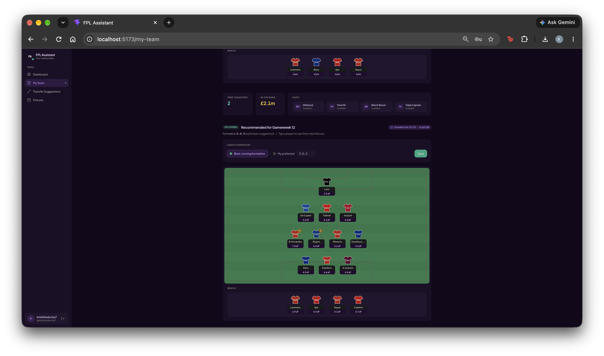
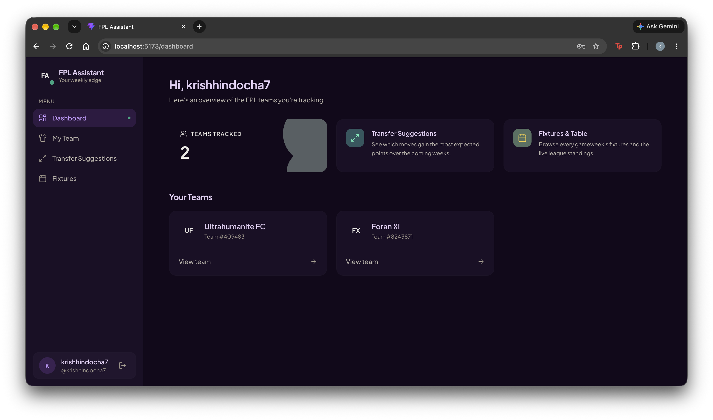
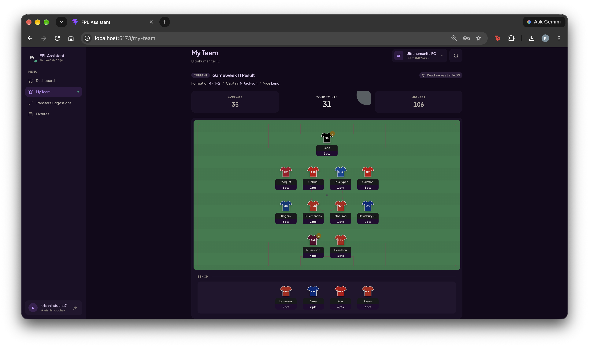
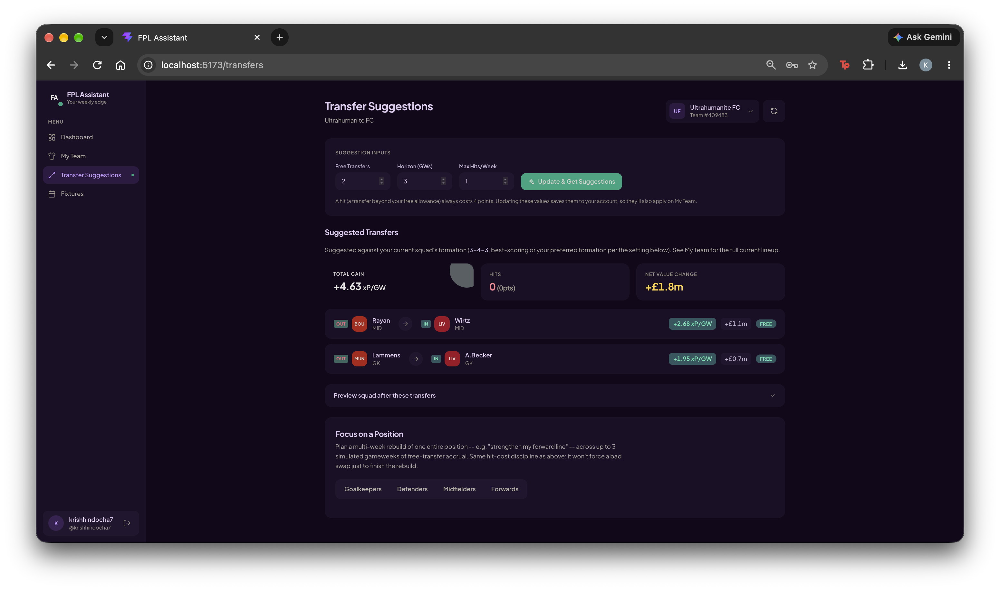
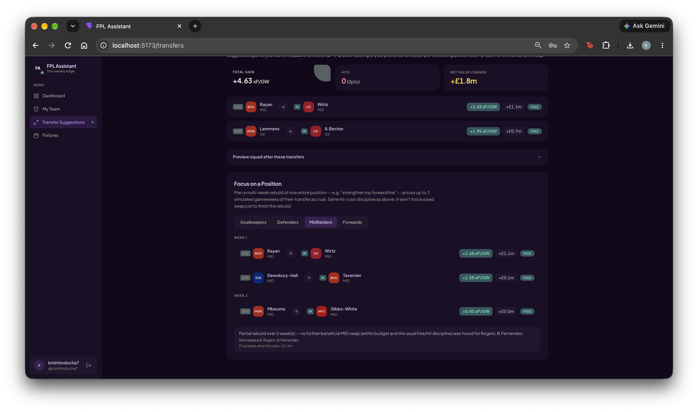
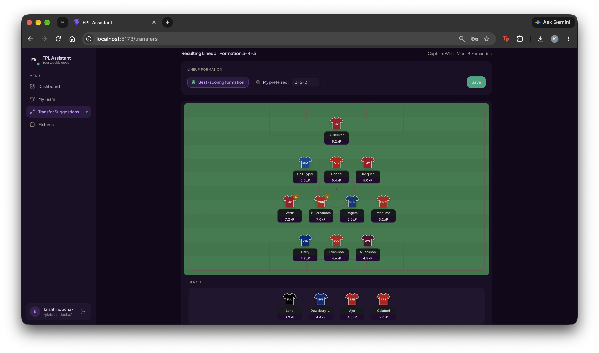
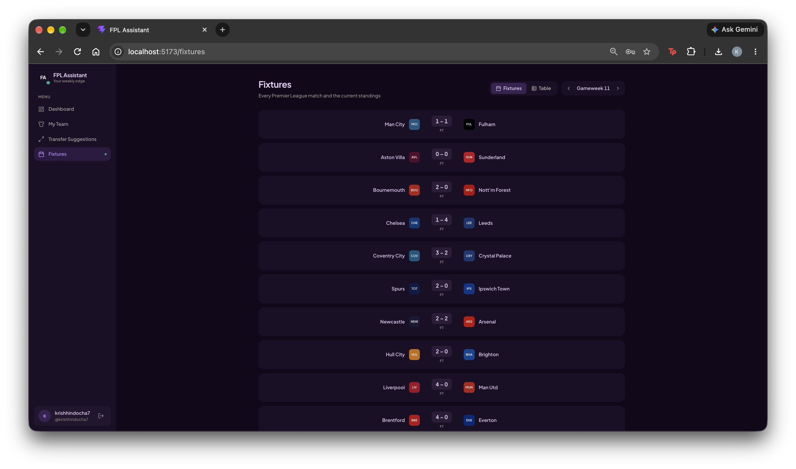
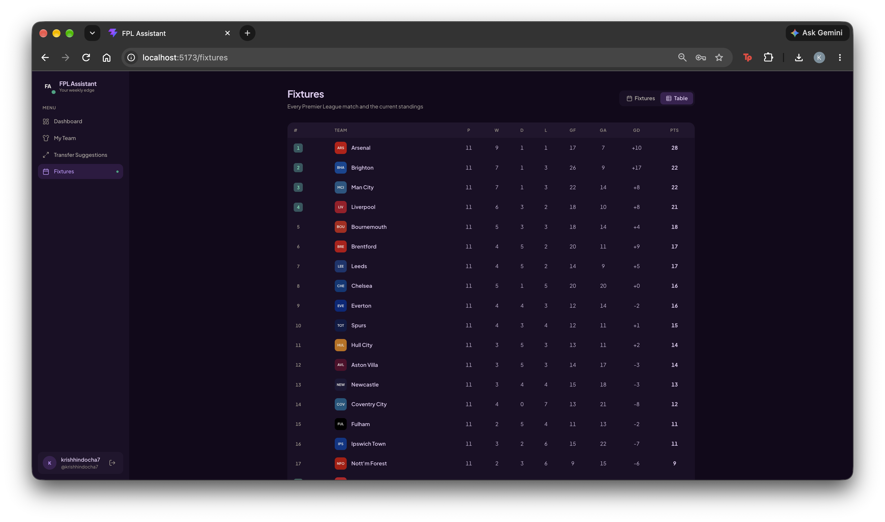
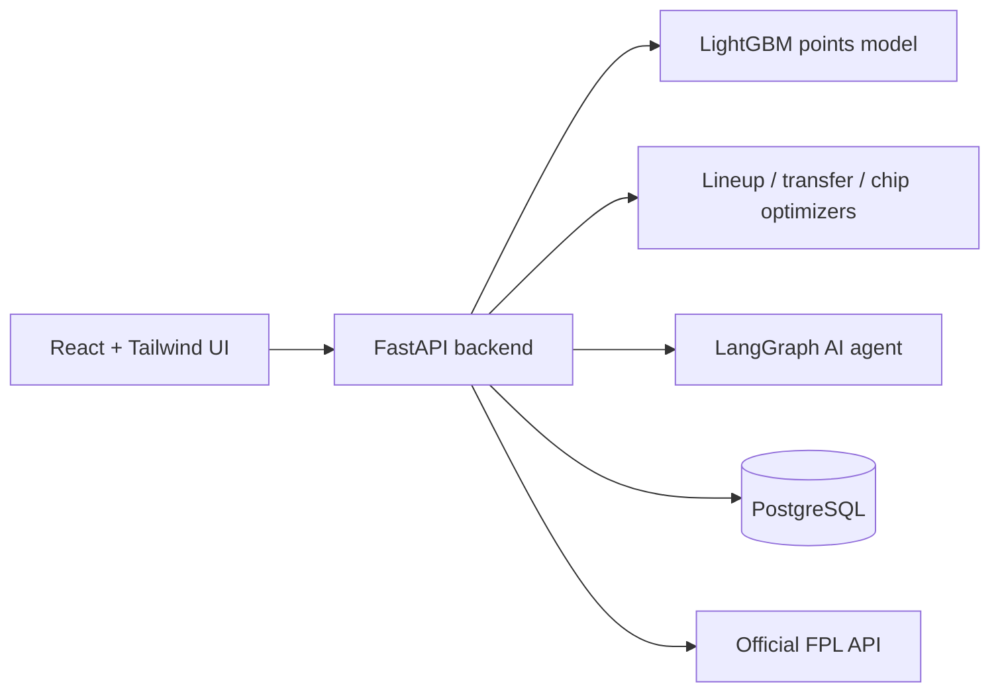

<h1 align="center">⚽ FPL Assistant</h1>

<b>An AI-powered Fantasy Premier League manager</b>

  
  
  
  
  
  
  

> 🔒 **Source code is private.** This repo showcases the project. Code is available on request for recruiters and interviewers.

## ✨ What it does
- 📈 **Predicts expected points** for every Premier League player each gameweek using a machine learning model trained on historical FPL data
- 🧠 **Builds your best lineup:** picks your starting XI, formation and captain, or uses your preferred formation
- 🔁 **Suggests transfers** and only recommends taking a points hit when the model is confident the transfer is worth it
- 🏗️ **Position rebuild planner:** plans upgrades to a whole position over several gameweeks
- 🃏 **Chip advisor:** tells you when to play Wildcard, Free Hit, Bench Boost or Triple Captain
- 📅 **Fixtures and live league table**
- 💬 **AI agent (backend):** a LangGraph agent that can answer questions about your team. It works through the API, and a chat UI is coming soon.
- 🔐 **Secure login**, with support for managing multiple FPL teams

## 🖼️ Screenshots

| Dashboard | My Team |
|---|---|
|  |  |

| Transfer Suggestions | Position Rebuild Planner |
|---|---|
|  |  |

| Lineup After Transfers | Fixtures |
|---|---|
|  |  |

| League Table |
|---|
|  |

## 🏗️ Architecture

## 🛠️ Tech stack
| Layer | Tech |
|---|---|
| Frontend | React 19, Vite, Tailwind CSS, React Router |
| Backend | FastAPI, SQLModel, Alembic, JWT auth |
| ML | LightGBM, pandas, scikit-learn |
| AI | LangGraph, OpenAI |
| Database | PostgreSQL (Docker) |

## 🗺️ Roadmap
- [ ] Chat UI for the AI agent
- [ ] Deploy a live demo
- [ ] Leagues page showing your rank in each of your FPL leagues
- [ ] Team analysis on the dashboard when you select a team

## 📬 Contact
Interested in the code or a demo? Reach me on [LinkedIn](https://www.linkedin.com/in/krish-hindocha-497978236/).